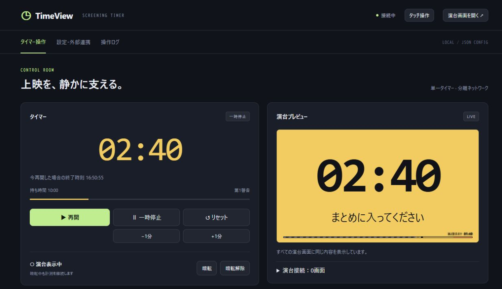

# TimeView

**演台に残り時間とカンペを届ける、会場LANで使えるタイマー。**

上映イベント・講演・カンファレンスで、オペレーターが手元から時間とメッセージを管理できます。演台には表示専用画面、司会者にはタッチ操作画面を用意。暗転中も計測を続け、解除するとその時点の内容を表示します。

配布実行ファイルを起動してブラウザを開けば使えます。利用時にGo・Node.js・データベースは不要です。Windows・macOS・Linux向けにビルドでき、通常運用はインターネット接続を必要としません。



## できること

| やりたいこと | TimeViewの機能 |
| --- | --- |
| 登壇者に残り時間を伝える | 大きな時間表示、2段階の警告色、経過ゲージ。時間超過後も計測を継続 |
| 手元から進行を支える | 開始・一時停止・±1分・リセット、終了予定時刻、演台プレビュー |
| 声を出さずに案内する | 自由文のカンペ、最大9件の定型文、非表示・再表示 |
| 上映の邪魔をせず待機する | 演台ページを黒一色にする暗転。起動時も暗転ON |
| 複数の表示を揃える | 同じLANのブラウザへ状態を自動配信。演台ページの応答を一覧で確認 |
| 現場に合わせて操作する | タッチ画面、USBテンキー、MIDI、HTTP API、UIなしリモコン |
| 次回も同じ設定で使う | 設定をJSON保存。画面から書き出し・差分確認・一括復元 |

1つのサーバーで1つのタイマーを共有します。表示文言は日本語・英語を切り替えられます。

## まず使ってみる

配布状況は[Releases](https://github.com/Surigoma/timeview/releases)を確認してください。以下は配布アーカイブを展開したフォルダーで実行する手順です。ソースから用意する場合は[開発ガイド](docs/DEVELOPMENT.md)を参照してください。

| 利用するPC | アーカイブ名の対象部分 |
| --- | --- |
| Windows（x64） | `windows-amd64` |
| Mac（Apple Silicon） | `darwin-arm64` |
| Mac（Intel） | `darwin-amd64` |
| Linux | CPUに合わせて`linux-amd64`または`linux-arm64` |

### Windows

```powershell
.\timeview.exe
```

### macOS / Linux

```sh
chmod +x ./timeview
./timeview
```

1. ブラウザで[操作画面](http://127.0.0.1:8080/)を開く。
2. 「設定・外部連携」で持ち時間・警告・表示を確認し、「設定を反映」を押す。
3. 「演台画面を開く」から表示を開き、操作画面で「暗転解除」を押して内容を確認する。
4. 演台を全画面にし、操作画面の「開始」を押す。

初回は**10分・待機・暗転ON**です。終了は起動したターミナルでCtrl+C。設定と操作ログを起動フォルダーへ保存するため、書き込みできる場所で実行してください。

### 別のPC・タブレットから使う

サーバーPCでLANからの接続を受け付けるよう起動します。macOS / Linuxでは`./timeview`に同じ引数を付けます。

```powershell
.\timeview.exe -listen 0.0.0.0:8080
```

同じ会場LANの端末から`http://<サーバーPCのLAN側IP>:8080/`を開きます。`0.0.0.0`は待受指定なので、ブラウザには実際のIPを入力してください。OSのファイアウォールでも会場LANからの8080ポートへの接続を許可します。

| 用途 | URLの末尾 |
| --- | --- |
| オペレーターの操作 | `/` |
| 司会者のタッチ操作 | `/touch` |
| 演台・投影用の表示 | `/display` |
| 設定・バックアップ | `/settings` |
| 操作履歴 | `/logs` |

**分離された会場LANでの利用を前提としています。** 認証・TLSは実装していません。「ブラウザからの操作だけを許可」は誤操作防止用の設定で、認証の代わりにはなりません。

### Dockerで起動する

リポジトリとDocker Composeを用意して実行します。

```sh
docker compose up --build -d
```

[操作画面](http://127.0.0.1:8080/)を開きます。設定とログは名前付きボリュームに保存されます。停止と保存先の扱いは[運用ガイド](docs/OPERATIONS.md#dockerの停止とデータ)を参照してください。

## 本番前に知っておくこと

- 設定は保存しますが、**実行中のタイマー・暗転解除・送信中のカンペは復元しません**。サーバー再起動後は待機・暗転ONです。
- 演台接続一覧で確認できるのはページからの応答です。映像の出力やモニターの電源は実際の機器で確認してください。
- 演台には名前を付けられ、応答なしの記録は削除できます。名前は一時的な接続記録に属し、演台ページの再読み込みなどで解除されます。
- ブラウザのKeypad操作は前面・フォーカスありのときに使います。ブラウザなしで常時入力を受ける場合は同梱の`timeview-remote`を使えます。
- ブラウザのMIDIは対応するChrome／Edgeと安全なコンテキストが必要です。基本の利用場所はサーバーPCの`127.0.0.1`です。

具体的な設定移行・接続管理・トラブル対応は[運用ガイド](docs/OPERATIONS.md)にまとめています。会場LAN・入力機器・表示機器でのリハーサルと、[未確認項目](docs/VALIDATION.md#未確認項目)の確認を行ってください。

## 詳細資料

| 資料 | 内容 |
| --- | --- |
| [運用ガイド](docs/OPERATIONS.md) | 上映前の確認、設定バックアップ、演台管理、Keypad・MIDI・リモコン、障害対応 |
| [開発ガイド](docs/DEVELOPMENT.md) | ソースからの起動、テスト、ビルド、リリース、API利用例 |
| [仕様書](docs/SPECIFICATION.md) | 動作仕様の入口。画面・API・受入条件への案内 |
| [OpenAPI](docs/openapi.json) | HTTP APIとSSEの契約 |
| [動作確認結果](docs/VALIDATION.md) | 確認日・確認済みの範囲・実機未確認事項 |
| [依存ライブラリの選定](docs/DEPENDENCIES.md) | Go・Reactで使うライブラリと選定理由 |
